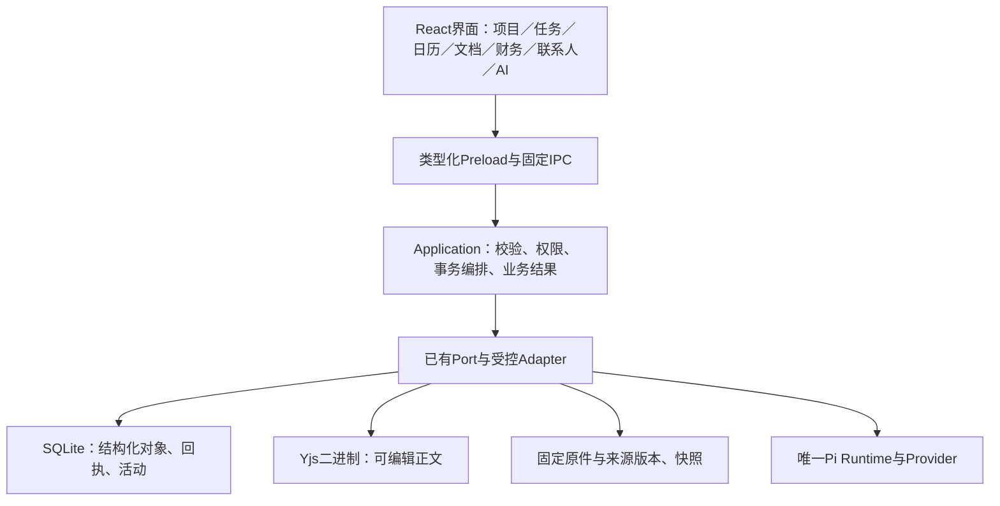

# CaseLite 软件工程白皮书

> **V3｜核心Linear设计与工程研究合并版（2026-11-14）**：本版补齐Initiative、当前/归档项目、工作区与Issue附属资源，对88份原生资源、361张Issue逐条形成设计适用性与功能映射；893个仓库文件逐条编目，其中349份生产源码共74112行及34份SQL迁移已全文语义读取；67项直接依赖核声明、锁定版本与消费者。132条附件/外链目标已补抓，PR描述与目录列表不冒充全部diff或递归源码审查。最新批准的统一编辑、事实D1、图示V1、PostgreSQL底座及R6边界纳入第13—18节，冲突实验与条件择优见第19节。主目录只更新原两份研究文档，README及规则/产品代码不变。

> 研究日期：2026-11-14（Asia/Shanghai）。适用对象：由非专业程序员主导、LLM参与开发的CaseLite原型。研究责任入口：[DEV-1847](https://linear.app/logixy-ai/issue/DEV-1847)；工程要求核验：[DEV-1904](https://linear.app/logixy-ai/issue/DEV-1904)；现有主控：[DEV-1828](https://linear.app/logixy-ai/issue/DEV-1828)。
>
> 本文是有日期的研究与建议，不替代实时Linear现行01—06、用户授权、AGENTS、ADR或实际源码。后续安排和验收状态只在原Issue维护。产品改动继续一次一张获准卡、单写入；commit、push、merge分别遵守用户最新授权。本轮没有进行产品仓库的这三项Git操作；仓外检查夹具的临时Git基线仅为验证所用。

> 编制范围已按用户本轮更新收口：以已取得的核心Linear合同、已批准架构/设计和本对话研究合并成文；代码核查与实验作为既有研究证据，不继续追踪其他开发任务或扩展研究。

## 1. 结论与适用边界

CaseLite现有架构可以继续发展，当前没有足够证据支持全库重写或更换技术栈。推荐采用**模块化单体、持续可运行骨架、最小纵向切片、分层测试、独立复核、同版本接收、可恢复数据**的方法。

核心改进应放在已有成果接合、真实功能验收、备份恢复、故障隔离和证据可追溯上。增加框架、提示词或任务数量，不能替代这些工作。

“每次开发一个功能，测试没问题再接入框架”的方向需要调整：从首个切片就接入真实UI→受控IPC→Application→真实存储，先走通最小用户结果，再逐步补完整能力。独立模块单测仍要做；不要等一个完整模块写完后才第一次集成。

工程化不能保证永不崩溃。可验证的目标是：故障影响范围有限、已确认保存的内容在已测试故障模型下保全、异常不误报成功、能定位原因、有可执行的恢复与回退路径。整机断电、介质损毁、设备丢失与程序强退需要分别设计和验证。

### 给产品负责人的五条判断

1. 每次只接收一个明确、可操作的用户结果，要求提供程序入口、样本、步骤和预期。
2. “代码已写”“单测通过”“CI绿色”“界面能点”“律师接受”分别记录。
3. 看到“已保存”后，必须有适用的重开、冲突与失败恢复证据。
4. 需要改多个模块时，先解释真实依赖与唯一数据Owner，再实施最小改动。
5. 代码可回退之外，还要验证数据库、正文、原件和固定交付物可恢复。

## 2. 全量来源、分析方法与证据边界

本版以Linear「CaseLite 产品开发」I-8为主边界，加入可识别CaseLite历史容器、工作区/Issue关联资源和设计引用闭包，保留现行与历史之分。

| 分母                 | 本版实际范围                                                                                                                                                    |
| -------------------- | --------------------------------------------------------------------------------------------------------------------------------------------------------------- |
| 当前未归档项目       | 8个，现行未归档Issue357张                                                                                                                                       |
| Initiative含归档容器 | 22个，全部Issue361张（含4张已归档参考卡）                                                                                                                       |
| 全部CaseLite项目容器 | 36个；额外14个历史容器本次Issue均为0，不重复计数                                                                                                                |
| 原生Resource正文     | 88份，已全部抓取正文并保存日期固定快照；39份未归档、49份已归档，未归档中还有3份标题“删除”                                                                       |
| 项目Resources条目    | 59个，是关系条目数；不能与原生文档数相加                                                                                                                        |
| Issue附件/外链       | 132条：68个PR关系（62个唯一PR）的元数据/完整描述、22个固定Plane文件和10个目录列表、1个协议目录、29上传引用（21个唯一文件）、2个已计入88的文档链接；深度逐条注明 |
| 依赖                 | 671条blockedBy边，361卡内未检出环，外部阻塞节点0                                                                                                                |
| 仓库文件             | 893个：349生产源码、221测试、34 SQL迁移、89 Markdown、170配置/支持、30二进制                                                                                    |
| 直接依赖             | 67个唯一包名，含3个workspace内部包；64个外部直接包，不是传递依赖总数                                                                                            |
| 空库结构验证         | 按本次快照migration-manifest顺序重放34迁移：61表398列，exit0                                                                                                    |

全部资源正文和Issue正文已拉取；逐条分析输出保存在仓外日期固定附件，动态状态继续由原Linear实体维护。现行资源按适用章节、最新增量、Owner、失败/回退和冲突进行分析；历史资源逐份核对适用性/归并去向，不将其全部历史段落当当前要求。Issue的逐项结果包括功能归属、处理建议、候选模块、所需验证、依赖和证据缺口；候选模块映射不证明该卡已接线或通过。

893文件逐条记录类型、hash、行数、入口/导入、Issue引用、职责、消费者和读取深度。349份生产源码、34份SQL迁移已全文静态语义读取；另有58份支持项全文语义读取、9份支持项全文结构读取。其余443项仅结构、局部断言或二进制元数据，不能写成全仓安全审计。测试文件只按实际读取/执行深度列证据，找到测试不等于运行通过。

实际代码：main/HEAD仍为9f0d7034500396c72e5689abaf603d92555de426，存在其他Owner的混合在途成果。固定研究副本893文件hash与本轮开始记录一致，但没有取得产品源码/构建/GUI写入权，因此仍是研究副本，不是主控交付候选。34迁移先在空内存SQLite重建结构，再以第19节合成数据比较机制；未验证Drizzle/Electron驱动、真实旧库带数据升级、真实案件或产品业务恢复。

新增关键设计来源：

- [统一编辑工作区](https://linear.app/logixy-ai/document/已批准方案caselite-pdftiptap-与多格式统一编辑工作区2026-11-14-d762c622a1ee)：11-14批准，1877等原消费者。
- [事实D1](https://linear.app/logixy-ai/document/已批准设计d1caselite-事实列表属性栏与ai对话框高优先级待排期2026-11-13-b4c4ad342618)、[图示V1](https://linear.app/logixy-ai/document/已批准v1caselite-可视化字段联动与ai图示调整仓外候选开发2026-11-13-4c6c9f188ced)：批准类型/开发位置不同，分别接收。
- [同步07采用节](https://linear.app/logixy-ai/document/远期合同07caselite同步协议持久化与恢复-0e3b701342ca)：PG底座已选，引擎仍由1681准入。
- [律师端/律所端边界](https://linear.app/logixy-ai/document/产品边界白皮书caselite律师端与律所行政系统分离-v102026-11-08-787385a284a2)：需结合1791/1792/1789的11-09及1793的11-10后续精简批准，不能由旧白皮书取消已批准个人辅助实现；新增正式行政权威另行裁决。

DEV-1681的PostgreSQL证据附件通过连接器实际拉取，ZIP为157563字节，SHA256为0634086845f59d7af08a1a60e6aa2268f4e734ccddf09bbd5cbf49838f1d5239；已核导出清单和阶段五至七校正。原FAIL、分阶段有限PASS和未测条件保留，本版没有重跑数据库压测/密码实验，也不以旧阶段三描述断言同一缺陷仍未修复。

上一版2026-11-14研究副本的56项测试、15项独立专项、安全及回归，以及2026-11-13的89+35项定向测试，继续属于原版本/环境。第7节保留其运行事实，本版新增来源/设计分析、逐文件独立核对及第19节研究实验；旧通过不转换成本版产品通过。

## 3. LLM开发方法论：七个相互衔接的环节

### 3.1 以用户结果和验收为起点

一个切片可以是“新建任务，输入正文，保存后退出重开仍能找回”，不宜是“完成所有任务模块”或“建好所有数据库表”。

开始前写清：唯一用户结果、业务Owner、执行者、独立复核者、允许文件、非目标、输入输出、失败行为、真实前置、验证、回退。路径由执行者根据当前代码填写，不要求律师预先指定类名或SQL。

验收样例须独立于实现：例如保存后的明确文字、精确金额、禁止的越权动作、相同键重复提交的预期。不能让实现和测试共同接受一个未经确认的业务错误。

### 3.2 保持一个持续可运行的骨架

骨架应包含真实导航、对象身份、保存状态、受控IPC、Application入口、存储装配、错误呈现与测试入口。未实现能力展示诚实空态或不可用说明。

骨架不是万能业务对象、通用CRUD或空包集合。日历、任务和项目可以消费同一任务身份；财务、联系人和文档仍保留自己的业务校验、权限及写事务。

### 3.3 实施小而完整的纵向切片


从早期即验证真实保存，减少最后接合时才发现协议、对象身份或事务不兼容的风险。先用合成数据跑通人工路径，再接入获准的AI、外部材料或协作路径。

Anthropic的长任务研究报告了“一次一个功能、保持可恢复状态、显式端到端测试”的价值；其Web演示不构成Electron产品可靠性的证明。[原文](https://www.anthropic.com/research/effective-harnesses-for-long-running-agents)

### 3.4 实现、复核和业务接收分开

沿用用户现行模型约定：Sol集中规划；Terra medium实现有边界的切片，最多初次加一次返修；重复同错、两轮未通过或高风险问题交Sol High；每项交付由独立Sol High上下文核对。

复核需要准确diff、适用合同、失败路径、测试原始结果和未测项。独立上下文可减少共同盲点，但不等于两名GitHub审批人，也不等于存储、安全或法律专业审计。

OpenAI官方建议明确结束条件、运行相关检查并审阅结果；仓库规则应描述重要不变量，机械规则交给可执行检查。[Codex最佳实践](https://learn.chatgpt.com/docs/learn/best-practices) · [审查规则](https://developers.openai.com/blog/custom-code-review-rules-for-codex)

### 3.5 失败先分类，再修复

先区分环境/基础设施、测试问题、产品缺陷、合同冲突。保留首次失败与命令，不盲目重试。最小复现应包含版本、入口、样本、操作、预期、实际、错误阶段和持久化结果。

修复顺序：重现→定位根因→增加能检出故障的回归→最小修复→同输入复测→受影响消费者回归→独立复核。重复失败时停止叠加功能，保全数据和在途成果。

### 3.6 以准确候选接收

存在未提交修改时，仅记录HEAD不够，还需工作树清单/hash、锁文件、规则指纹、环境和产物hash。测试A版本不能为后来的B版本放行。

应由现有主控统一接合，列出每个已纳入成果、来源Owner、仍缺的验收。共享Schema、迁移、Main、Preload、锁文件及GUI保持串行写入，不让多会话覆盖同一资产。

### 3.7 用质量结果评估进展

关注一次接收通过率、返修次数、严重缺陷逃逸、复发率、定位/恢复时间、恢复成功率、待验收滞留和律师返工负担。不要用代码行数、测试文件数、模型自评或Issue百分比替代质量。

DORA 2025将AI视为组织能力的放大器，强调收益取决于底层工作系统；它不能证明增加AI调用必然改善交付。[研究](https://dora.dev/research/2025/dora-report/)

## 4. 推荐技术架构及现有技术栈判断

### 4.1 保留客户端模块化单体，云端采用已批准的独立模块化单体



图表示职责与数据权威，Yjs不是另一套独立数据库。当前正文二进制由既有存储持久化；JSON/HTML/文本是可重建投影。Agent、MCP和未来连接器也须通过Application，不能绕过权限与人工确认。

### 4.2 当前真实目录

```text
apps/desktop/src/
  main/                     宿主生命周期、装配、受控IPC、平台适配
  preload/                  最小类型化IPC桥
  renderer/
    features/               projects、tasks、documents、finance、contacts、agent等
    editors/                统一Tiptap内核及场景配置
    shared/                 UI、导航、普通读取、统计等纯公共机制
    ui/                     工作台和逐步归拢中的旧业务入口
packages/
  contracts/                DTO、版本、错误和Zod运行时格式
  application/              用例、Port、领域编排
  local-db/                 SQLite、迁移、Yjs持久化与各领域存储适配
scripts/                    质量、安全、架构、打包与演示检查
tests/                      合同、集成、合成样本
docs/adr/                   长期决定及失败/回退依据
```

当前共享库workspace包为contracts、application、local-db三个，另有desktop应用workspace。Domain、files、独立PDF或sync-client等职责定位不表示已有包；在真实消费者出现前不预建。

### 4.3 技术栈与取舍

下表版本来自本地manifest与锁定配置，不是“最新版本推荐”。安装状态、漏洞和生产适用性仍须独立验证。

| 层级              | 当前采用                                                            | 本研究判断                                                        |
| ----------------- | ------------------------------------------------------------------- | ----------------------------------------------------------------- |
| 桌面              | Electron45.1.0、Forge8.0.1、Webpack5.112.2                          | 保留唯一构建主链；原生ABI与最终包继续实测                         |
| UI                | React19.3.1、TypeScript6.0.3、CSS                                   | 保留；按消费者提取组件，避免全局大状态与跨页业务引用              |
| 格式与边界        | Zod4.6.7、固定IPC/Application/Port                                  | 保留；静态类型之外必须验证输入、sender和对象范围                  |
| 结构化存储        | better-sqlite3 13.0.3、Drizzle0.45.4、SQL迁移                       | 适合当前本地单体；忙锁、事务、旧库、迁移失败与恢复需实测          |
| 正文              | Tiptap3.32.3、ProseMirror、Yjs13.6.33                               | 保留单一正文权威；编辑器状态不等于落盘回执                        |
| 材料/导出         | React-PDF11、PDF.js6.3.289、mammoth1.13、docx9.15.3、本地Vision OCR | 按已启用格式验收；输入限额、原件保全、导出保真分别核对            |
| 读取/视图         | TanStack Query5.107.1、Table8.21.3、React Flow12.12.1               | 作为读取缓存、列表或图表投影，不成为业务真源                      |
| AI                | assistant-ui、AI SDK UI、唯一Pi Agent Core/pi-ai1.5.0               | UI transport与Runtime职责明确；不能因多套UI库产生第二Run/会话权威 |
| 工具              | Node24.22.2、pnpm11.0.9、Vitest5.0.5、ESLint、Prettier              | 已有足够基础；固定环境运行，避免PATH中的Node26误代Node24          |
| 云同步底座        | 已批准PostgreSQL＋TypeScript/Node/Fastify＋同地域对象存储           | 生产版本/部署未定；端侧E2EE，数据库已选不等于引擎/上线通过        |
| 同步引擎/知识扩展 | 1681原A/B门禁及各自消费者                                           | 不提前安装服务器/第二队列/向量库/正文内核；知识专属仍延期         |

规则执行器的新近批准是ZEN默认、固定OPA WASM可选，归DEV-1908；语义候选归DEV-1909/1687。它们尚待正式接合及真实桌面验收，不能写进“已投入使用的核心技术栈”。

### 4.4 建议的领域职责

| 能力           | 权威与主要规则                                      | 跨模块方式                                                        |
| -------------- | --------------------------------------------------- | ----------------------------------------------------------------- |
| 项目           | SQLite项目属性及关系；描述复用公共正文              | 通过Application关联任务/文档/财务；项目不是所有对象的强制父级     |
| 任务           | 独立稳定Task身份；状态、日期、归组、说明按原合同    | 列表、项目、日历消费同一对象；不按入口重建任务                    |
| 日历           | 区分任务日期、人工日程、提醒、外部只读来源          | date-only与带时区时刻分别处理；法定期限不能由普通日期算法擅自推导 |
| 文档           | Document身份、Yjs正文、修订/回执；固定交付快照      | 统一编辑器和领域入口，入口只传scope/初始值，保留独立草稿状态      |
| 原件与来源     | 固定字节/hash、SourceVersion、Anchor                | OCR和预览只派生；不得覆盖原件、旧锚点或旧交付物                   |
| 财务           | 精确金额、收费/应收、回款、分配、冲回和开票各有语义 | 项目待收为投影；不以删除收款纠错，不把开票等同到账                |
| 联系人         | 稳定身份与项目角色关系                              | 同名不自动合并；项目角色与联系人基本资料分开                      |
| AI Agent       | 确认输入范围、唯一Run身份、权限与停止/中断历史      | 结果先为候选，经受控Application和适用人工确认写回                 |
| 知识库         | 复用Document及来源版本；分类、标签、收藏为元数据    | 专属模板、沉淀、共享仍按延期范围；本次列入研究不自动复工          |
| 事实与法律分析 | Fact/Citation/Anchor原子关系；判断由律师确认        | 可视化是投影，不能另建一套图表事实库                              |

### 4.5 对现有实现的具体评价

保留：真实Renderer→Preload→Application→SQLite链路；同连接事务；修订、稳定幂等键和保存回执；Yjs正文；固定版本和单一Runtime方向。

需要继续核对：

- main/index.ts约1807行、App.tsx约1734行，装配/演示/业务入口集中。行数是定位线索，不能当作自动拆分阈值；先找可验证的职责接缝。
- task-store组合多个领域Store，包边界不等于领域规则已解耦。提纯具体规则时仍须保留同事务Owner。
- Task目标的Yjs表示与现行02/DEV-1704存在既有对齐事项。由原Owner决定，不在UI重构时暗改格式。
- 普通App的页面级错误恢复入口未在本轮定向搜索中确认；找到的ErrorBoundary主要在工程PDF入口。已存在窗口能力撤销测试，但不能据此推导用户可恢复页面。
- SECURITY等文档仍有P0“尚无凭据”等历史文字，而实际代码已有safeStorage路径。应沿1562/1904清理适用说明并执行要求的独立回归，不能在本研究中直接改安全规则。

## 5. 参考产品：能学习什么、不能推断什么

用户所列“caeefleet”“colando”按Casefleet、Colanode研究。

| 软件      | 可核验的参考价值                             | CaseLite采用建议                         | 证据边界                                     |
| --------- | -------------------------------------------- | ---------------------------------------- | -------------------------------------------- |
| Linear    | 任务/项目、Owner、状态、筛选、导航与开发节奏 | 保留对象身份，视图和业务写入分离         | 研究官方行为与方法；不虚构其内部目录         |
| Plane     | 公开前后端、共享包、Issue与视图组织          | 参考公开入口、领域服务与消费者边界       | 固定源码抽样；不能当成Linear内部源码         |
| Casefleet | 事实、主体、争点和来源关联                   | 保留原文版本、原子引用、时间线与人工核验 | 官方功能文档；没有本轮可核验的产品内部源码   |
| MyCase    | 项目/日历/文档/联系人与收费协同              | 借鉴多入口一致性及运营闭环               | 官方功能描述不证明内部架构或实际可靠性       |
| Clio      | 事务、客户、财务与文档集中工作               | 借鉴关联关系和状态可追溯                 | 不直接引入境外信托会计/收费口径              |
| Harvey    | Threads、Vault、Workflows、History与Library  | 借鉴选定材料、来源、候选和历史           | 厂商功能描述不证明法律质量、内部栈或模型路由 |
| Docmost   | 页面/正文、服务/仓储、协作与投影             | 统一正文机制，保留本地修订与回执语义     | AGPL及商业边界，不复制实现                   |
| Colanode  | 本地数据、queries/mutations、文档与同步队列  | 借鉴本地事务和失败处理职责               | 不照搬统一节点CRDT或提前建设云Outbox         |

功能来源：[Casefleet](https://support.casefleet.com/en/articles/1982995-key-concepts-in-casefleet)、[MyCase](https://www.mycase.com/features/)、[Clio](https://www.clio.com/features/case-management/)、[Harvey](https://help.harvey.ai/articles/getting-started-with-harvey)。表中采用建议是本研究分析。

### 5.1 固定源码版本与深读方式

| 仓库              | 本轮复用的固定SHA                        | 许可与范围                       |
| ----------------- | ---------------------------------------- | -------------------------------- |
| makeplane/plane   | 618d0eb74658329a6f6e92434ac54231422c5b96 | AGPL-3.0；只读研究               |
| docmost/docmost   | ce4d8931745e0bb95b738ec10cf73aa642dfd2c3 | AGPL-3.0及商业目录边界；只读研究 |
| colanode/colanode | d649523637f0f059c936418488165d4a689da27c | Apache-2.0；本轮未复制实现       |

上一轮交接还列出Plane9cefae8…、Docmost3a3e812…两个不同版本。本轮保留已有固定副本，不宣称已审读这两个版本增量，也不把固定快照描述为上游最新状态。原28仓库/全历史PR任务范围保持；本白皮书仅完成其中方法论与三仓库重点研究增量。

逐文件索引只能证明路径、hash或符号已被机器处理。语义深读必须记录具体文件、行段、调用者、数据权威、失败和测试；源码采用另须原消费者、确切许可/NOTICE及批准。

### 5.2 Plane：对象与视图分离，但不能照搬云端结构

目录：apps/web为前台，apps/api/plane为Django/DRF后端，apps/live为协作；共享包有types/services/editor/shared-state/i18n等。本快照前台配置应按React Router/Vite核对，不沿用旧Next.js印象。

实际链路：Issue详情store→IssueService→API；详情按同一Issue身份组织评论、活动、附件、订阅、关系和子项。updateIssue按项目Issue/Epic服务选择Owner，同时刷新活动。

证据：[issue.store.ts 87—190](https://github.com/makeplane/plane/blob/618d0eb74658329a6f6e92434ac54231422c5b96/apps/web/store/issue/issue-details/issue.store.ts#L87)；[API依赖](https://github.com/makeplane/plane/blob/618d0eb74658329a6f6e92434ac54231422c5b96/apps/api/pyproject.toml)；[API工作流](https://github.com/makeplane/plane/blob/618d0eb74658329a6f6e92434ac54231422c5b96/.github/workflows/pull-request-build-lint-api.yml)。

工程化发现：workspace和共享包便于复用，但根build/check命令存在不等于全部业务测试运行。所读API工作流主要执行ruff，且有分支、路径和Draft条件；不能称其覆盖了所有业务路径。

CaseLite决定：采用同一对象多视图、明确服务入口、按变更消费者回归的机制；保留本地Application/SQLite权威。不引入Plane的Django/PostgreSQL/Redis/Celery整套部署，也不照搬其所有并行刷新行为。

建议消费者：1800/1801/1803普通读取与列表、1905任务多入口、1795共享评论。验收关注同一对象从项目/列表/日历修改后读到一致版本，以及快速切换时旧结果不串页。

### 5.3 Docmost：正文内核、领域服务与协作持久化分层

目录：apps/client/src/features为功能界面；apps/server/src/core为业务服务，database/repos为仓储，collaboration为Yjs/Hocuspocus接线；packages/editor-ext为编辑扩展。

实际链路一：PageService.create检查父页面存在和同space，解析内容，生成正文/文本/Yjs状态，委托PageRepo插入。调用者传事务时，watcher在同一事务中登记，避免后台任务引用未提交页面。

实际链路二：PersistenceExtension.onStoreDocument派生编辑JSON和文本，将Yjs二进制与投影放在事务更新；异常被捕获后保留贡献者状态。是否对用户可靠确认保存仍须结合上层协议，不能只见回调完成就宣称持久化成功。

证据：[page.service.ts 116—199](https://github.com/docmost/docmost/blob/ce4d8931745e0bb95b738ec10cf73aa642dfd2c3/apps/server/src/core/page/services/page.service.ts#L116)；[persistence.extension.ts 104—175](https://github.com/docmost/docmost/blob/ce4d8931745e0bb95b738ec10cf73aa642dfd2c3/apps/server/src/collaboration/extensions/persistence.extension.ts#L104)；[chunk-load-recovery.ts](https://github.com/docmost/docmost/blob/ce4d8931745e0bb95b738ec10cf73aa642dfd2c3/apps/client/src/lib/chunk-load-recovery.ts)。

工程化发现：功能目录不代表没有大服务，所读PageService仍很长；Web chunk恢复包含联网判断和重载冷却，属于Web部署故障机制，不能直接用于Electron未保存正文恢复。公开release流程也不能证明全部内部CI。

CaseLite决定：复用统一正文内核、领域服务与持久化分工；保留本地expected_revision、稳定幂等键、未知回执查询及固定原件。AGPL/商业代码不复制。消费者仍为1818、1798、1877、1623/1624及原导出卡。

### 5.4 Colanode：本地事务与同步职责值得参考，失败语义必须单独验证

目录：apps/desktop/server/web/mobile；packages/client/core/crdt/ui。client进一步区分databases、queries、mutations、handlers、services和同步作业。

实际链路：DocumentUpdateMutationHandler→DocumentService.updateDocument→对象/权限与格式校验→同事务登记文档、Yjs update、待同步mutation、文本和引用→事件与同步服务。MutationService处理待发送、服务器结果与失败重试。

证据：[document-service.ts 44—98、144起](https://github.com/colanode/colanode/blob/d649523637f0f059c936418488165d4a689da27c/packages/client/src/services/workspaces/document-service.ts#L44)；[document-update.ts](https://github.com/colanode/colanode/blob/d649523637f0f059c936418488165d4a689da27c/packages/client/src/handlers/mutations/documents/document-update.ts)；[PR测试工作流](https://github.com/colanode/colanode/blob/d649523637f0f059c936418488165d4a689da27c/.github/workflows/pr-tests.yml)。

具体反例：固定版本的updateDocument最多重试10次，循环内异常被捕获，耗尽后可返回undefined；Handler仍返回success:true。2026-11-13已有模拟数据库异常的受控复现。本轮重读源码并保留原MOCK_ONLY结论，没有运行其完整产品或认定CaseLite存在同一缺陷。

CaseLite决定：学习事务内权威数据与派生投影一致性、重试有界、同步职责可定位；拒绝“调用结束就是保存成功”的推断。CaseLite回归应验证真正持久化结果、提交后丢ACK、原键查询、重复提交和重开。当前不引入Colanode整套节点模型或同步队列。

## 6. 防止局部故障演变为无法修复的问题

### 6.1 区分三种边界

- 代码边界限制依赖与耦合，帮助定位和修改。
- 进程与权限边界限制不可信内容和能力传播。
- 数据提交与恢复边界决定异常后哪份状态可信。

模块拆目录不能防止主线程卡死；Worker也不自动具备受限磁盘/网络权限或OS级内存硬上限。具体生命周期、资源预算与沙箱要求沿1863/1865等原卡验证。[Electron安全建议](https://www.electronjs.org/docs/latest/tutorial/security)

### 6.2 故障矩阵

| 故障                   | 应有行为                                         | 必需证据/责任                           |
| ---------------------- | ------------------------------------------------ | --------------------------------------- |
| 页面渲染异常           | 显示可恢复入口，保全草稿边界，其他页面可用       | 普通页面异常注入；1904归口Owner核定     |
| Renderer退出           | 撤销旧能力，旧回调不能写新对象；恢复时明确状态   | 1861/1864真实Electron场景               |
| PDF/DOCX/OCR过慢或异常 | 有界输入/队列/时间，取消后不生成假ready          | 1863/1865及材料消费者；CPU/RSS/响应时间 |
| SQLite写失败或忙锁     | 回滚；保留输入与原幂等键；不显示已保存           | 1590/1623、存储集成与故障注入           |
| 提交成功但回执丢失     | 显示unknown，查询原结果，再决定后续动作          | 原提交键/对象/修订可核对                |
| 迁移失败或未来库       | 保全原库，明确拒绝或隔离恢复                     | 1826/1590两支历史与不兼容版本           |
| AI超时、Stop、迟到     | 保存partial/终态，拒绝跨对象回调；不自动付费重放 | 1650—1655/1699/1713分别接收             |
| 外置盘掉线/权限改变    | 明确不可用，不误写到替代空目录                   | 1833/1855及本地目录消费者               |
| 财务重复/冲回错误      | 原键幂等，约束分配/冲回，历史可追溯              | 1793及R6原业务卡                        |
| 导出失败               | 原文和固定快照不变，临时/成品状态明确            | 1628/1703/1629及1816                    |
| 坏备份/缺件            | 隔离拒绝或恢复，当前工作区不被覆盖               | 1593，GUI打开恢复结果                   |

### 6.3 备份与回退必须有独立方案

备份应覆盖一致截点下的SQLite、Yjs正文/绑定/修订、固定原件和引用清单；密钥和可重建索引按既有合同分开处理。SQLite Online Backup API解决数据库一致副本，跨文件集合仍需一致清单和恢复协议。[SQLite官方文档](https://sqlite.org/backup.html)

Git回退恢复代码，不恢复用户工作数据。旧程序可能不兼容新库；优先保留原库与隔离恢复，不用旧程序覆盖或删表“降级”。历史快照、同步、副本和可重建投影均不能单独替代完整备份。

RPO（允许丢失多少已完成工作）和RTO（希望多久恢复）应由产品Owner在1593中明确。建议先验证最近一次成功备份可完整恢复，再按实际使用频率决定自动备份与异地副本；本报告不擅自承诺具体分钟数或新增外发目的地。

数据丢失、写错对象、越权、原件被覆盖、错误财务计算应阻断对应交付。一般视觉问题按影响排期，避免与数据安全问题混为一个级别。

## 7. 测试完整性：保留上一版运行证据，当前产品仍不能判定完整

### 7.1 历史实际运行（不是本版产品验收）

| 检查                               | 结果                                | 适用范围                                                             |
| ---------------------------------- | ----------------------------------- | -------------------------------------------------------------------- |
| 架构边界脚本                       | PASS_REAL，exit0，347个生产源码文件 | 检出故意Renderer→Node/Application负例；不是任意动态代码安全证明      |
| 测试完整性脚本                     | PASS_REAL，exit0，220个测试文件     | 检出故意test.skip；文件数不是用例数或覆盖率                          |
| 6个变更相关文件                    | PASS_REAL，56/56，exit0             | 联系人/属性配置、工作台标签、本地目录hook与真实SQLite集成；UI为jsdom |
| 2026-11-13定向测试                 | 历史PASS_REAL：89集成+35界面        | 属于原副本/环境；相关源码变化需重新判断适用性                        |
| 完整quick/ci/full                  | NOT_RUN                             | 本轮不写产品代码、不抢共享构建，定向通过不能代替完整门禁             |
| 普通模式原生GUI、系统IME、物理故障 | NOT_RUN                             | 不能用jsdom或工程探针代替                                            |
| 真实Provider与法律质量             | NOT_RUN                             | 本轮没有付费模型调用或真实客户材料                                   |
| 完整备份/隔离恢复及律师接收        | NOT_RUN                             | 原责任卡尚不能由本轮证据放行                                         |

执行使用项目固定Node24.22.2及已安装Vitest入口，没有安装新依赖、编译或改写产品锁文件。准确命令、耗时、退出码、日志与副本清单保存在仓外本轮研究目录。

### 7.2 现有脚本的边界

check:quick包含格式、lint、架构、测试完整性、差异、安全、类型、单元、合同与许可证；不包括全部集成和真实桌面。

ci增加联网依赖审计、集成与覆盖率，并显式将原生e2e列为not-run。full增加macOS打包与test:e2e，而test:e2e当前指向打包PDF/IPC/SQLite工程探针。

独立静态复核还发现：check-quality-changes在检测到回归触发、但未传入require-regression参数时只警告；没有其他违规仍可exit0，quick/ci/full目前均走普通review。因此触发本轮回归的交付，必须另外执行现行带回执命令并核有效结果；普通绿灯不能证明独立回归完成。是否把缺回执改为自动阻断由1562/1564/1904原Owner按获准规则变更处理，本轮不改检查器。

因此full不是“所有普通用户业务已测试”的同义词；专项demo和普通模式完整旅程仍须按消费者执行。未完成的联网审计如实记录。现有Vitest覆盖配置统计生产源码，但没有据此建立完整业务覆盖矩阵，覆盖率单值不能证明没有遗漏。

### 7.3 建议的能力覆盖矩阵

| 能力      | 正常与关键负例                                                 | 必要环境                                   |
| --------- | -------------------------------------------------------------- | ------------------------------------------ |
| 项目/任务 | 多入口同身份、重复提交、版本冲突、归档/恢复、重开              | 单元/合同/SQLite及普通桌面                 |
| 日历/提醒 | date-only、时区/DST、睡眠唤醒、重复触发、外部只读              | 纯函数+宿主/系统验证                       |
| 正文      | 真IME、撤销/重做、迟到ACK、unknown、坏Yjs、保存后强杀          | 单元/集成+原生桌面                         |
| 文件      | 坏格式、预算、取消、软链接/路径替换、hash失配、断盘            | 适配器/隔离文件系统+桌面                   |
| 财务      | 整数分、分期合计、同键重试、超额分配、冲回、开票/实收区分      | 冻结业务预期+真实SQLite+GUI投影            |
| 联系人    | 同名不同身份、角色关联、归档、跨范围拒绝、重开                 | Application/存储+GUI                       |
| AI        | 预览=实际发送、权限拒绝、Stop迟到、重启不自动发、候选接受/拒绝 | 模拟Provider回归+获准真实Provider+律师金标 |
| 知识/同步 | 仅已激活范围；来源核验、索引重建、重复/断连/撤权               | 原卡专项，不用规划替代测试                 |
| 全局      | 冷启动、旧库迁移、故障隔离、备份恢复、升级回退                 | 最终准确包、隔离工作区                     |

每个适用格子记录责任Issue、固定样本、预期、实际命令/步骤、环境、版本/hash及PASS_REAL/MOCK_ONLY/NOT_RUN/BLOCKED/FAIL。缺少实现的能力应明确未实施，不能靠增加Mock测试宣称存在。

## 8. Linear设计评估与任务治理

### 8.1 当前未归档主线组织（357卡）与全量历史分母（361卡）

| 项目                       | 本次Issue数 |
| -------------------------- | ----------: |
| P-DEV-102 工程化与质量保障 |          60 |
| R0 主控/准备               |           5 |
| R1 单任务生产              |          79 |
| R2 项目、任务和提醒        |         104 |
| R3 知识库及文档管理        |          15 |
| 端云同步与协作（原R4）     |          36 |
| R5 Pi-law harness          |          47 |
| R6 财务与客户              |          11 |
| 合计                       |         357 |

上表是357张未归档主线。全部361张另含4张已归档参考卡，全量状态为33已完成、101待验收、42开发中、15已明确可开发、167待排期、3取消；这些归档卡不恢复排期。42张开发中有32张assignee为空；正文可能另有Owner，故只能据此要求核实，不能认定无人执行。

项目分工不应直接变成八个服务或八个并发Agent。保留业务原卡、通用工程归P-DEV-102、端云同步专属工程归原R4新名Project、当前主控单写入是合适方向。671条依赖无环只说明图结构没有检出循环，不证明依赖都合理、产物已可用或计划可按期完成。

### 8.2 建议治理方式

1. 原Issue最前只保留当前短执行摘要：结果、执行/复核Owner、允许文件、准确候选、下一动作、缺的验收；历史原文保留并明确历史地位。
2. 先接收已完成实现和待验收成果，再决定新增代码。把101张待验收按“已进候选/仓外候选/缺接线/缺测试/缺人工接收”核对，不再开发同样能力。
3. 硬依赖应说明缺少哪个真实产物会导致哪项验收失败。父卡负责联合接收，叶卡保留单一实现Owner。
4. 每次只准备当前卡和后续2—3张。不得用“无blockedBy”代替用户授权、源码写入权和实际前置核对。
5. 知识库专属能力仍延期；近期1687/1908/1909限定审查范围继续归原Owner，本白皮书不改变其授权。
6. 不批量改状态、指派、优先级或依赖；研究与规划不自动Done。

当前优先收口：1829/1838已有成果接合；1593及1755/1590真实前置；1657完整代表任务验收。1564保留独立预演/人工接收；1594保留公开分发独立准入。

## 9. Codex、Linear、GitHub是否足够

**足够作为当前核心工具链。**还需要已存在的本地测试、打包、合成样本、诊断和备份能力真实运转；这些是工程能力，通常无需再采购一套项目管理平台。

| 载体                | 权威内容                                | 需要避免                                           |
| ------------------- | --------------------------------------- | -------------------------------------------------- |
| Linear              | 产品范围、批准、Owner、依赖、业务验收   | 用状态代替可运行成果；多处复制动态合同             |
| Git/GitHub          | 源码、准确diff、回退点、PR/CI、远端规则 | 把本机HEAD当作包含全部WIP的版本；未经授权提交/推送 |
| 仓库文档            | 稳定接口、ADR、命令、测试与恢复方法     | 新增平行任务台账；把旧规则当当前授权               |
| Codex或替代编码工具 | 消费真实来源，实现、测试、复核          | 把提示词当强制权限隔离或把聊天记忆当唯一交接       |
| 仓外证据目录        | 测试原始结果、候选清单、私有研究快照    | 向Public仓库提交真实材料、凭据或完整私有记录       |

上一版联网核实[main规则26296669](https://github.com/Casefe/caselite/rules/26296669)：active、禁止删除和强推、要求PR和Linux quality gate；必需审批人数为0，未要求code owner或最后push独立批准。[main工作流](https://github.com/Casefe/caselite/actions/runs/43125642510)成功，10个打开PR均为Draft；本版补抓86个PR元数据集合仍见10个打开Draft。规则与CI的前述事实保留其原核对时点，不能代当前候选放行。

现状已有平台门禁，但独立技术审查没有仅凭该规则得到强制。先明确可用独立审阅身份，再按管理员授权决定审批规则；不能让同一账号的两轮AI冒充两名审批人。[GitHub说明](https://docs.github.com/en/repositories/configuring-branches-and-merges-in-your-repository/managing-protected-branches/about-protected-branches)

本轮没有更改仓库权限、CI、模型路由、凭据或宿主配置。用户的最新AGENTS明确：commit、push、merge需分别授权，旧自动授权不延续。

## 10. 不依赖开发工具的长期交接

工具更换后，依然应能从以下资产重建开发：

- Git中的源码、锁文件、构建/测试脚本和必要合成fixtures；
- 现行合同的稳定ID与可读导出，原Issue ID及跨工具映射；
- ADR、接口/Schema版本和数据权威说明；
- 准确候选、原始证据、失败记录与恢复说明；
- 独立复核结论和律师操作验收步骤。

本版88文档与361完整Issue、893文件与67直接依赖逐项分析及实验脚本/原始结果的仓外快照可用于迁移时核对。它是日期固定的可移植输入，不成为新的在线权威；更换工具时应重新核实时效并保留旧ID/链接。原始导出可能包含私有信息，应按原访问权限保管。

开发入口、命令和验收不能只存在Codex技能或聊天里。新工具首先读取AGENTS、SOURCES及原Issue，再核对当前HEAD/工作树、真实前置和写入权。工具专属配置只作为薄入口，不能复制另一套业务规则。

附带[行动方案](../plans/engineering-action-plan.md)给出了原责任卡、最小产物、交付格式与新会话提示词。本研究通过仓库普通文档入口和Linear工程化Resource接入；GitHub文档提交包准备完成后仍须按用户授权发布，不能宣称本轮已同步。

## 11. 近期行动顺序与产品负责人验收

建议下一批最多三项，由现有主控结合当前在途安排领取：

| 建议顺序                   | 原责任入口                          | 可观察结果                                                 |
| -------------------------- | ----------------------------------- | ---------------------------------------------------------- |
| A 同包接收既有成果         | 1828/1829/1838，1904映射证据        | 一个准确候选可启动，纳入/未纳入成果和剩余验收明确          |
| B 备份与隔离恢复           | 1593及1755/1579/1590前置            | 从设置备份，在新目录恢复后用界面找回任务、正文、原件、快照 |
| C 故障隔离及代表任务总验收 | 1861/1863/1864/1865、1657及各领域卡 | 坏文件/停止/保存失败可恢复，同包完成完整用户链             |

A不要求所有长期候选实现；B按真实前置推进；C不省略1657原合同中的搜索、OCR、来源回跳等承诺。1904发现无原Owner的故障恢复缺口时先形成最小问题归属，不借研究直接批准大重构。

产品负责人现场验收可要求：

1. 用合成样本新建项目/任务，输入中文及表格，看到已保存后退出重开。
2. 从任务列表、项目和日历打开同一对象，核对修改一致。
3. 导入正常与损坏文件，确认坏文件没有破坏已有工作。
4. 获准AI发送后Stop，重开可见partial和状态，没有自动再发送。
5. 登记部分回款、重复提交与冲回，核对余额及开票彼此独立。
6. 从固定快照导出并打开Word/PDF，后续编辑不改变旧交付。
7. 在隔离环境恢复备份，用界面打开原任务、正文、原件和快照。

系统故障注入、强杀、权限和迁移由工程执行者在隔离环境操作，律师查看结果。每次交付不要求律师阅读源码或数据库。

## 12. 研究交付与证据边界

本版完成88资源与361张Issue正文抓取、893文件逐项编目和349生产源码/34迁移全文语义读取、67直接依赖核对、132附件/外链目标补抓与逐项说明，以及合成数据冲突比较。上一版56项定向测试和独立15项专项保留原环境/范围。本研究不表示361张Issue完成，不关闭原28仓库/全历史PR研究任务。

产品数据写入、共享构建/GUI、真实Provider、完整备份恢复、签名公证/公开发布均未由本轮执行。新方法论不解除现行权限、源码许可和独立回归门禁。后续业务与工程决定继续由原Owner在实时来源接收。

## 13. 与现有设计结合后的产品及工程边界

### 13.1 入口与对象身份

用户已批准的“打开文件夹直接工作”和原独立Task闭环应同时支持。进入文件夹不强迫先建Task/项目，目录授权不等于模型选材授权；关联或归组继续保持稳定Task/Document/Source身份。基础人工使用不依赖云服务、律所系统、AI或付费权益。

本研究不提出新的通用WorkObject、EAV或Workspace Runtime。复用现有个人材料、目录绑定及Application入口；34迁移中的61表不是61个服务，更不是全部同步白名单。

### 13.2 采用分成四层

| 层次               | 已确认方向                                                                       | 尚不能推断                                           |
| ------------------ | -------------------------------------------------------------------------------- | ---------------------------------------------------- |
| 当前代码栈         | Electron/React/TS、SQLite/Drizzle、Tiptap/Yjs、Pi、现有UI/质量工具               | 已声明依赖不等于干净安装、无漏洞或全部功能验收       |
| 已批准且待生产接入 | PG/Node/Fastify/对象存储；统一编辑壳；事实D1/图示V1各自范围；ZEN/固定OPA原消费者 | 不表示已部署、正式持久化、真实模型或律师接收完成     |
| 条件实验           | PowerSync或Mutation/Delta、Pagination/Table Plus、Excel/PPT轻预览/有限副本修改   | 实验通过不等于生产采用，不能追加第二引擎/正文/运行栈 |
| 规划/延期/待裁决   | 学习经验层、AI三项设置未接线增量、付费脱敏、知识专属及新增正式R6行政权威         | 既有个人辅助财务批准保留，未批准增量不因研究自动启用 |

这四层写进每次交付摘要，防止“参考过/安装过/做过Mock”逐步变成未经批准的产品承诺。

## 14. 逐功能与源码职责对齐

以下是对当前设计与实际模块的研究判断。路径表示真实候选实现位置，具体文件许可仍由领取原Issue时确定。

| 功能组            | 现有设计和实际接缝                                                                               | 结合后的处理与关键验收                                                                   |
| ----------------- | ------------------------------------------------------------------------------------------------ | ---------------------------------------------------------------------------------------- |
| 工作台/页签       | WorkspaceTopbar、useWorkspaceTabs、App/未保存保护                                                | 统一编辑页复用同一页签身份；长标题、切换、关闭、草稿/unknown保全                         |
| 项目/任务         | task/catalog Application及Store；列表/项目/日历消费同Task                                        | 保留同身份多入口；普通状态、日期、归组与业务关系不随UI复用合并                           |
| 项目文档/全局文档 | DocumentWorkspace、DocumentCanvas、BodyEditor、ProjectDocuments                                  | 全局/项目scope独立，复用正文机制；不共享选择/滚动/未保存状态                             |
| 公共属性栏        | PropertyRow等UI、property-panel-config、各领域回调                                               | 1906 V2保持字段/视觉/保存不变；首页没有真实属性栏则N/A                                   |
| 正文保存          | task.ts→TaskApplication→TaskStore；BodyEditor修订/回执                                           | 自动保存仍须CAS/幂等/unknown原键查询，不能用布局状态代替落盘                             |
| PDF/原件/来源     | material/source合同、MaterialApplication、受控文件Adapter                                        | 固定SourceVersion/Anchor；坏文件/预算/取消可恢复，阅读隔离单独验收                       |
| DOCX/Word工作稿   | 1811既有Mammoth/净化/schema→Tiptap/Yjs工作稿                                                     | 同一原件再次编辑回到同一工作稿；原件hash/旧引用不变，复杂格式损失明确                    |
| 双页与对照        | 批准PDF相邻页/Tiptap1843分页；固定源码PDF仅挂单Page，Tiptap未真实分页；既有SplitPreviewWorkspace | 三种动作分开，不把两份文档对照或CSS分栏冒充相邻真分页                                    |
| HTML/图片/Office  | 1622、1690与格式Adapter                                                                          | 壳统一、权威不统一；XLSX/PPTX有限样本/动作验证，写新副本并原应用回读                     |
| 快照/导出         | delivery-snapshot/export/store，export-style及原出口                                             | 固定修订+配置；预览和保存同产物；HTML/Word/PDF及图表1887分别验收                         |
| 日历/重要日期     | task-calendar、important-date规则/Store、提醒Application                                         | 普通日期/时区、人工确认候选、外部只读、投递状态分开；不推导法定期限                      |
| 联系人            | contacts合同/Application/Store及独立表单                                                         | 同名可并存、个人/组织/事项角色分开；不扩大为CRM或自动合并                                |
| 财务/报告         | finance/finance-management/source三条既有入口                                                    | 保留已获准个人辅助的金额/幂等/冲回；正式行政权威和越界新增另裁决，原数据与合同不自动废止 |
| Agent/历史        | agent-input、AgentApplication、Pi Adapter、history-store                                         | 选材/实际载荷、Run/候选、Stop/迟到/重启、真实Provider分别验收                            |
| 单段文档审阅      | document-review-application与reader，原Task保存Owner                                             | AI SDK UI只是transport；不新增Run库、通用聊天存储或绕过保存事务                          |
| 事实/议题         | litigation-fact-design设计合同；仓外1583/1584候选                                                | 当前主目录V1不是D1正式持久化；先接收已有V2候选，字段/权限/存储分验                       |
| 图示/统计         | ProjectVisualization、React Flow、原1884—1887与1910/1911                                         | 当前六模式示例不当正式四图；直接字段投影、语义候选、视图配置/快照分开                    |
| 知识/检索         | Document/catalog、现有分类/标签/收藏、原检索消费者                                               | 中文短词/否定/权限先于分页；专属分区、模板沉淀和共享维持延期                             |
| MCP/CLI/API       | 1670—1674、1832、1899/1900原入口                                                                 | 只读/外部来源/候选写回分向；归档专项参考不独立授予新工具权限                             |
| 同步/协作         | 07＋1681实验，当前本地Owner仍在设备                                                              | PG云端不加载明文Y.Doc；三通道授权/队列/ACK/游标/撤权及真实设备逐卡接入                   |
| 设置/智能化       | 1746导航；1652三项设置；1878—1882学习规划                                                        | 模型提建议，宿主执行；主题/字数/模式白名单不含凭据/删除/脱敏/学习授权                    |
| 分发/多语言       | 1594、1869—1875原卡                                                                              | 与功能研发独立准入；不翻译原始法律材料、不因英文界面扩模型/同步授权                      |

### 14.1 统一编辑工作区的工程接收

统一的是页签、工具栏、更多菜单、可用状态与辅助栏容器。PDF、Tiptap、HTML、图片和Office不被强制转成同一个正文结构。属性/AI默认收起只改变显示，不能卸载编辑器、丢输入、取消Run或复制一套生命周期。

Word由Tiptap打开已获批准，其具体含义是固定DOCX原件经转换预览进入同一工作稿；不承诺全部分页/修订/页眉脚注往返保真。Excel/PPT仅统一位置与状态，HTML预览/LLM修改仍属1690有限可行性验证；公式写入与重算、PPT文字替换与重渲染分别验证。新库、云转换和第二Python Runtime不由模拟批准自动采用。

原分工保持：1877壳与复用接线；1734 PDF工具；1842格式/纸张视图；1843分页实验；1811 DOCX工作稿；1622附件；1690跨格式实验。

### 14.2 事实D1与既有合同差异

D1要求记录类型、可无来源事实、精度日期、稳定编号、多主体/多议题，以及**核对、争议、定位三个独立轴**。主目录当前V1设计仍将verification_state设为unverified/verified/disputed，citation最少1条、relation含uncertain。因此不能把旧DTO直接接新UI，也不能把uncertain改名为background或猜测旧disputed的人工核对含义。

1583已有仓外V2两文件候选及独审记录，1584已有主体/议题分类候选。行动应是核准这些既有准确候选并接合，后续由1633/1634/1635/1637实现，而不是重做合同。设计测试通过不证明IPC权限、正式事实表、回跳或律师产品已通过。

### 14.3 图示V1的更新机制

1910的直接投影从已保存对象/修订刷新；材料变化导致的新语义推断进入待复核，不自动改事实。显示标签/位置与业务内容分开，自定义标签不被源刷新覆盖，拖动节点不改事件日期。来源v2不静默替换引用v1。

1911只在支持动作内生成带来源/视图修订的建议，预览/应用/取消/撤销均有版本约束。应用版式不等于确认事实，旧建议过期不能直接应用。1887固定图快照冻结事实/引用/视图/字体或渲染版本，源更新不改旧成果。统计按可见唯一对象口径，分组次数不当唯一事实总数。

## 15. PostgreSQL采用、同步实验与本地可靠性结合

### 15.1 已选数据库，尚未选生产引擎

云底座采用PostgreSQL＋TypeScript/Node/Fastify模块化单体＋同地域对象存储；生产版本、厂商、规格及实际部署未定。PG17.12是已有隔离实验版本，不默认生产锁版。客户端继续SQLite/Drizzle、Yjs和固定原件/快照权威。

PG持必要公开授权/传输元数据与密文接纳/顺序/回执；案情、正文、附件内容在端侧加解密和校验。RLS只是纵深机制，不替代可信身份/统一鉴权；当前密码/actor实验夹具不能进入生产。附件体不塞入业务明文表，通知可丢但应能补拉。

PowerSync与精简Mutation/Delta仍由1681在共同安全/可靠性合格后按原130% TCO判据二选一。不得给成熟引擎再造一份第二Pending，不能以PG/MySQL吞吐替代引擎选择。当前本地业务不提前依赖云Outbox或在线登录。

### 15.2 34迁移与61表的实际含义

本版用Python标准库在空内存SQLite重放快照中34个迁移，实际得到61表398列。字段所有权不能只搜schema.ts：原PG附件盘点明确19表由原生SQL消费。设备路径/定位、Key、投递执行状态、缓存与toolchain_probe不能照表上传。账号偏好、设备偏好、业务事件、云ACK必须逐字段分开。

空库重放证明本次SQL顺序在该SQLite引擎能形成结构；不证明Drizzle迁移账本、两支旧库带数据兼容、当前产品升级或已部署云Schema。已提交55表/360列是原证据中的HEAD口径，与本次含在途0033的结构不同。

### 15.3 继承已有阶段五至七，继续最小缺口

阶段五旧格式Pending/回执兼容有保留vault/旧key、可信Application与固定SDK前提；阶段六16项及3次SIGKILL、阶段七单Document/epoch1正文41项及8次SIGKILL均属于原隔离研究。原汇总SQL失败仍保留FAIL，117项只读补验不改写首次失败。

下一增量是同space两Task/Document/body与结构化变更混排，验证路由、批次冻结、坏项整批回滚、唯一队列/seen/应用进度原子性。之后才是真实附件体/ready、正文跨epoch与快照/Pending恢复、公开SDK写入中强杀、当前HEAD适配、物理设备/Keychain/TLS/弱网和成本。A的占位cursor=0不能当SDK checkpoint。上述阶段通过不能替代备份1593或1711/1669产品接收。

## 16. 需要保留或正式裁决的设计差异

| 差异                                          | 本版处理                                                                                                                                | 原责任                            |
| --------------------------------------------- | --------------------------------------------------------------------------------------------------------------------------------------- | --------------------------------- |
| 律师端不做完整行政，与已有R6结算/经营报告并存 | 先核11-09/10后续精简批准，保留已批准个人跟踪/核对与数据；完整行政总账/支付税务API/正式权威反写等新增由Owner另行裁决，不自动撤销获准成果 | 产品Owner、1837及R6原卡           |
| Task-first与文件夹直接工作                    | 区分业务闭环验收与入口；1855允许文件夹开始，保留Task身份/按需关联                                                                       | 1855、1553/1576/1599              |
| 旧页面大标题/三栏常驻与11-14统一壳            | 同范围以较新的明确批准为准，属性字段/正文/AI状态保护继续适用                                                                            | 1877及原消费者                    |
| 六模式Mock与四类专业图                        | 页面模式是表达；正式数据/引用/持久化/快照必须原领域接线                                                                                 | 1802、1884—1887、1910/1911        |
| 主目录事实V1与已批准D1                        | 明确版本适配/拒绝和旧字段迁移语义；先接收已独审候选，不能通用update伪造人工确认                                                         | 1583/1584、1633—1637              |
| 旧“数据库待选”与PG采用                        | 更新本白皮书采用层；引擎/部署/费用仍分离                                                                                                | 07、1681                          |
| 同步总验收依赖延期1721                        | 真实DAG边保留，列主控范围/排期决定；不自行删边或复活知识共享                                                                            | 1669/1721、1828                   |
| MCP专项已归档而当前合同仍引用                 | 保留出处并核适用章节/Owner，不能把归档资源独立当开工许可                                                                                | 1581、1670—1674、1680             |
| 项目AI旧先选Task与1787直接项目scope           | 当前空项目可直接对话，默认仅标题/状态/类型/优先级/目标日；打开只本机读，发送才提交，不自动带任务/材料/历史                              | 1787覆盖1776/1778/1783/1786旧文字 |
| 旧项目五/六栏目与最新1712                     | 当前概况/文档/事实/可视化四栏目，活动进更多；不因导航接线宣称事实/图示完成                                                              | 1712与各领域消费者                |
| 旧知识库复用与当前延期                        | 1836/1873/1632/1702/1721专属及1717复用联合接收延期；通用文档分类/标签/收藏与1687/1726/1727单独接收                                      | 现行01/03及原卡                   |
| 外部日历双向与1831只读                        | 外部事件只读并跳系统默认日历；现设置明示外部读取尚未接入，不把设置页当已实连                                                            | 1831覆盖1823/1824旧双向           |
| 旧规则/模型/Git授权                           | 最新人类指令和根AGENTS优先；文档研究不改变工具权限                                                                                      | 1562/1828                         |

对于已存在多个口径的事项，研究输出应提供具体差异和可选处理，不用“统一架构”暗中裁决产品业务。其余不依赖该决定的获准工作继续，避免单项待决阻塞全软件。

## 17. 逐技术栈分析的采用与退出要求

67个唯一直接包按manifest逐项列版本、声明位置、实际导入消费者、职责和风险；workspace包与第三方包分开。当前未新增依赖，也未声称干净安装或许可证审计通过。主要层次如下：

| 技术层                                  | 沿用决定                             | 针对性验证与退出                                                  |
| --------------------------------------- | ------------------------------------ | ----------------------------------------------------------------- |
| Electron/Forge/Webpack/原生驱动         | 一套桌面/打包主链                    | ABI、资源/Worker、Fuses/CSP/窗口和最终包，不能为测试降安全开关    |
| React/TS/CSS/布局                       | UI组件复用，业务回调/会话不合并      | 配置字段稳定、主题/窄窗/焦点/IME、隐藏不重挂；可逐页回退          |
| Zod/Application/Port                    | 运行时DTO/权限/版本与错误            | 非法/跨scope/旧修订拒绝，失败不写假成功                           |
| SQLite/Drizzle                          | 同连接事务、迁移账本、正文/回执/活动 | 旧库/崩溃/unknown/忙锁/磁盘，代码回退不降级覆盖新库               |
| Tiptap/ProseMirror/Yjs                  | 单一正文权威与多场景配置             | 真IME/撤销/表格/不支持节点拒绝/重开；分页与云协作分别准入         |
| Mammoth/DOMPurify/XML/ZIP/docx          | 受控转换和固定导出                   | 输入预算/净化/原件不变、损失说明、预览/保存一致及原应用回读       |
| PDF.js/react-pdf                        | 固定来源的阅读/选区/定位             | Worker打包、坏文件/旋转/重复文字/页码、解析隔离和取消             |
| Query/Table/React Flow                  | 读取缓存、列表和图示投影             | scope/修订/失效/迟到、唯一计数；不得成为第二写入权威              |
| assistant-ui/AI SDK UI/Pi               | 多UI消费者、唯一业务Run与Runtime     | 输入载荷/权限/停止/历史/候选分别验证，避免双会话/双预算           |
| Vitest/Testing Library/jsdom/Playwright | 单套已有测试机制                     | Mock、jsdom、工程探针、普通Electron、OS与律师验收分列             |
| ESLint/Prettier/Secretlint/质量脚本     | 机械门禁和拒绝负例                   | 检查器/规则变化走既有独立回归，不能通过改评分断言变绿             |
| PG/Node/Fastify/对象存储                | 已批准云底座，未生产安装/部署        | 服务端独立Schema、端侧E2EE、持久ACK/幂等、恢复/资源预算/同规格TCO |
| ZEN/固定OPA、分页/Office候选            | 各自原卡有限消费者                   | 实际工件/许可/预算/失败；不因候选加入当前核心manifest             |

某个已声明包找不到字面量导入时，可能由构建脚本/配置、插件或间接入口消费。先核具体入口，不凭静态零命中自动删除依赖。升级和移除仍要按原消费者、许可和退出成本决定。

## 18. 本版行动与验收覆盖

本次修订落实为：原白皮书和行动方案更新、原Linear研究Resource修订、全量逐条附件归档。未创建产品功能Issue、未改既有卡状态/人员/优先级/依赖，未把研究判断变成代码或架构新授权。

现有A同包接收、B备份恢复、C故障隔离主线继续。当前已批准编辑壳/属性治理按主控在途队列接收；事实/图示先消费已有候选；同步从1681当前最小缺口推进；R6只对明确待裁决范围提出决定，不中断其他获准工作。

在第7节原矩阵上新增设计断言：同Document相邻双页不复制正文；不同文档对照不重挂编辑；DOCX原件到同工作稿不重复覆盖；事实三轴/缺来源/背景与不确定不混用；图示直接更新/语义待审/自定义/固定快照独立；三项设置白名单拒绝Key等写入；学习撤回/旧备份代次、脱敏保护失败零派发；云多Document混排和三通道耐久/授权。全部按原卡实际执行和准确候选留证，不以本研究对照表勾选通过。

本版研究可验收条件：88资源、361 Issue、893文件、67直接依赖均有唯一记录与读取深度；关键设计与实际实现有具体差异、原Owner和最小处理；源数据/模型/费用/门禁未被擅改；独立上下文复核准确diff和证据。它不构成完整产品功能、安全或法律质量验收。

## 19. 全量核查、冲突实验与条件择优

本节是2026-11-14本轮增量，优先校正前版有关“仅空库结构验证”和旧资源覆盖数的描述。原始失败、旧版本测试和原合同继续保留，不能将其改写成本轮产品通过。

### 19.1 本轮完整性和读取深度

初始枚举工作区180份文档筛出87份；收尾按更新时间补新增1份核心规划和10张新卡，形成88资源/361卡，相关既有修订按精确增量读取；49份已归档，另3份虽未归档但标题标删除。36份当前适用资料和52份历史/归档资料分开解释。36个相关项目容器逐个列取Issues/Resources，所有分页结束；去重361张Issue，其中4张已归档，本轮357张未归档与361张含归档的分母不能混用。

逐资源、逐Issue、逐文件与逐依赖结果以日期固定附件提供，每项保留原ID/路径、hash、适用性、职责、消费者、保护测试、失败/恢复和读取深度。支持文件、二进制与历史重复条款不冒称代码全文安全审计。132条附件/外链已逐目标补抓：26图引用中18个唯一图已实际查看，D1 HTML内嵌设计内容已读，PG ZIP核原hash和相关证据；PR抓元数据/完整描述，参考文件抓固定文本、目录抓直接列表。未复核所有历史PR patch、未递归全文读所有外链目录，也未执行设计HTML或把截图当产品验收。

本轮固定研究快照893文件与本轮开始的逐文件hash全部匹配，含349生产源码、221测试、34 SQL迁移、89 Markdown、170配置/支持、30二进制；正式产品Owner没有由此交出写入权。生产源码349/349、74112行与迁移34/34均全文语义读取；361卡当前独有条款逐项核对，其中原20卡及新增10卡全文，其余按当前条款/历史适用性读取；收尾54张原卡只核具体差异，重复历史不逐字重审。最终记录无缺项/重复，读取深度见附件。没有读完的条目不能写FULL_SEMANTIC，没有运行的测试不能因找到文件而写PASS。

### 19.2 先约束正确性，再比较成本

“最优”在本文指满足当前已批准功能、权限、数据保全和恢复门槛的候选中，根据固定样本比较后的条件选择。稳定性、可靠性是硬门槛；速度、输入大小和开发便利不能补偿越权、漏数据、误报保存或财务口径错误。

比较应固定：相同数据/权限/版本、相同必要输出、明确故障模型、相同运行环境和成本边界。区分真实SQLite机制、真实Schema上的合成编排、真实产品Application、原生桌面和律师接收。结构相同不等于产品实现相同，Mock通过不当成已接合。

维护性用具体影响评估：是否新增权威源、数据模型/协议、核心依赖、常驻进程，是否扩大共享文件、失效处理和恢复路径。不能凭行数或一次微秒测试称维护成本最低，也不为追求某个指标换库/建第二缓存权威。

### 19.3 基于当前数据结构的实验

SQLite类实验使用固定快照的真实34项迁移，按manifest/journal顺序逐项核SHA后重放，形成61表398列并填入合成记录。UI选择、信封/代次及财务参考计算等纯模型不执行这些SQL，分别按原脚本层次记录。Python3.14.4/SQLite3.53.0只属于研究引擎，不冒充better-sqlite3/Electron ABI。样本全合成，真实客户资料、真实库、付费Provider和生产云资源均未使用。

Terra初次实验因财务表后续已增加列、脚本仍用无列名INSERT而失败；改为显式列名后17条观测符合预期。首次失败保留，记实验脚本问题，不算产品缺陷。独立Sol High逐字节复制重放这17条；再补26条机制/合成编排及5条UI选择模型观测，均与预期一致。48条是研究观测总数，包含成功复现失败方案的反例，不能写成48项产品功能通过。

| 比较                                     | 实测与选取                                                                                   | 结论边界                                                                                          |
| ---------------------------------------- | -------------------------------------------------------------------------------------------- | ------------------------------------------------------------------------------------------------- |
| 同连接同事务 vs 分段提交                 | 四个故障点下，同事务恢复旧指针/正文/回执/活动；分段前三点留下部分状态                        | 沿用同库事务；没有证明跨介质可恢复提交失效，也没有实测断电                                        |
| 原键+摘要匹配 vs 丢回执后换新键          | 原键返回原结果、改摘要拒绝；新键模型重复活动；补充旧修订及错Task/Document/Body/workspace拒绝 | 真实task-store已有摘要、身份、修订及事务保护；实验不证明其产品路径存在同类缺陷                    |
| 带旧修订条件更新 vs 无版本覆盖           | 两独立连接读同一旧修订后，迟到CAS影响行数为[1,0]                                             | 支持拒绝迟到覆盖机制；不是并发调度、磁盘或完整编辑器验收                                          |
| 范围过滤后分页 vs 全局分页后过滤         | 1000/10000合成记录，前者与golden页精确一致，后者漏项并错页                                   | 产品TaskStore实际已先过滤；退化反例不是当前查询缺陷证明                                           |
| 运行中只拷主sqlite文件 vs backup API     | WAL保留提交时，主文件副本漏新标题，backup得到新标题                                          | backup只解决数据库截点；原件/快照清单与恢复仍归1593                                               |
| 整数分与既定财务不变量                   | SQL拒绝小数分、重复有效所内分配/受保护更新及重复冲回；整数参考例得全部未收七万、到期未收三万 | 所内finance_allocations不等于客户回款全流程；开票/垫付/内部费不改余额已确认，原实验未执行产品路径 |
| 弱身份检查 vs 冻结完整对象/修订/代次集合 | 弱模型放过同workspace错对象、改文本、旧代次、取消、重复项；严格研究模型拒绝所设反例          | source字段与信封是合成模型，不能称真实Manifest或任意输入安全证明                                  |
| 旧项目页+全局较新重归属对象              | 当前选择表达式模型可选到已移出项目的新对象；替换后重核scope及代次可拒绝                      | 属静态风险输入及合成模型；真实React Query窗口、属性写回和IPC未实测                                |

当前产品已有正确机制时优先复用，并把原反例交原消费者回归，不重新实现一遍。新模型不是直接可上线的安全协议，不能因研究通过而新增生产表、Run、缓存或权限。

### 19.4 Token经济性：不把字节或错误方案当费用证据

同一授权集合、相同十项必要对象和顺序，扫描选取与复用索引两候选都执行完整研究信封核验和序列化，输出完全相同：3943 UTF-8字节、2343字符。每规模各7次：

| 目录规模 | 扫描装配中位数 | 已建索引装配中位数 | 索引首次构建 | 一次构建+装配 |
| -------- | -------------: | -----------------: | -----------: | ------------: |
| 1000     |       57.500μs |           34.166μs |     43.125μs |      77.291μs |
| 10000    |      232.375μs |           34.000μs |    442.000μs |     476.000μs |

因此重复装配可复用已有可靠索引；单次小目录扫描更简单，本样本首次建索引反而更慢。索引失效、权限变更、跨对象一致性和维护成本没有量化，不能为这些微秒新建第二真源。计时未包含SQLite、IPC、网络、Provider推理和UI，且仍受缓存/调度影响。

全目录输送另测得390001/3900001字节；它与明确选定十项的授权/信息量不等价，只用于揭示过量装配，不纳入胜者或真实节费百分比。两个合格候选的输出字节相同，不能声称其中一个减少模型Token。

本轮未运行Sol/Terra tokenizer、真实Provider或法律质量评测。UTF-8字节、字符、离线装配耗时、上下文Token、计费Token、订阅额度和账单必须分开；真实Token/费用及质量等价仍未知。建议继续在权限内按需选材、固定修订、派生确定性字段和预算拒绝，后续以获准真实调用的usage及律师金标验证，而不是用“全文更少”替代正确性。

### 19.5 最新增量与须收窄的旧结论

- 11-14 Office方向已获批准先做合成样本验证；首次soffice工具检查exit127，已停止。公式重算、PPT版式/副本重开和产品AI写回均NOT_RUN；不能继续称只有分析建议，也不能以ZIP有效称写回通过。
- 脱敏最新R3仍先不开发。十三项选择及四屏示意已确认，手工修正前移、本机用户作用域、无单次旁路、Run内存映射和1912离线签名30天权益不再待重决；凭证/时间异常等由P0形成，质量未实测、价格/支付后置。最终包装保护、原图零旁路、映射不静默回流及分权继续保持。
- 用户已采用PG/Node/Fastify/同地域对象存储；生产版本、厂商和部署未定，PowerSync/Mutation-Delta仍按1681共同可靠性与TCO门槛选择。本轮SQLite实验不选生产同步引擎。
- 文档双页、事实D1、图示V1已有批准和仓外候选；应接收既有成果并补当前缺口。主目录缺接线不能推导候选不存在；研究不抢接合Owner。
- 1791/1792/1789的11-09及1793的11-10个人辅助精简批准继续有效，不能以11-08白皮书单句非目标暂停；完整行政权威等新增范围仍待决定。既定金额口径不退回未知，数据库约束不代产品决定。

本次实验与全量核查支持保留客户端模块化单体、既有事务/版本/回执和按scope读取，并把最新批准设计落实到原消费者。未满足共同门槛、缺产品实测或需要业务裁决的方案继续列待决定，不能为了白皮书“选出冠军”伪造全局最优。

## 20. 逐文件核查发现的具体接收缺口

以下均绑定本轮固定源码。静态不一致与合成反例用于指定原Owner的最小复现，未经真实产品路径验证的条目不写“现版已发生漏洞/已修复”。不通过删测试、自动改业务口径或覆盖数据消除差异。

| 发现                                 | 源码/合同证据                                                                                                                                     | 原最小处理                                                                                                                            |
| ------------------------------------ | ------------------------------------------------------------------------------------------------------------------------------------------------- | ------------------------------------------------------------------------------------------------------------------------------------- |
| 0033标注“仅追加”，实际重建材料两表   | 0033_local_folder_workspace.sql先TEMP备份、DROP两表、重建再复制；不是纯ADD COLUMN                                                                 | 1855/1826/1590按非空旧库、FK、故障/强杀与原字节保全验证；不能用空库重放代替                                                           |
| 审阅候选完整性门槛不一致             | AgentApplication.apply_review检查succeeded/纯文本，未检查output_incomplete；联系人/日期路径已有该拒绝                                             | 1788/1727及原Run Owner补同scope不完整输出反例，明确允许/拒绝语义；未复现不自称修复                                                    |
| 部分目录成功回执核对较弱             | useCatalog的r.ok、文档标签onSuccess与DocxDraftPreview的r.ok，不等于BodyEditor的原键/目标/修订精确核对；RecordList归组测试夹具允许空receipt/target | 原目录/文档/项目消费者注入错receipt、另一对象、旧version及迟到，再决定最小修复；沿一族归口，不重复立多个相同缺陷                      |
| 部分status查询失败可能释放原请求身份 | TaskContentEditor、useSnapshotExport、DefaultFolderSettings、DiscussionFeed的部分status失败分支清原键；状态查询失败不证明原update未提交           | 原保存/导出/目录/评论Owner核unknown、失权恢复与原键查询；以useCalendarCommit、TaskBulkActions、Reminder的模式区分为参照，不盲新键重试 |
| 当前页与全局较新投影混用             | RecordList先取当前页，再用全局较新同ID对象替换，未再次核项目；五个合成选择观测已记录                                                              | 1905/1800及原属性消费者做重归属+旧页+迟到回调的真实组件回归                                                                           |
| 收起与导航不是同一生命周期           | 辅助栏隐藏已有保留子树机制，但App页面epoch/条件栏目可重挂正文/Inspector                                                                           | 1877/1729分别验隐藏/展开、A→B→A、项目栏目切换；不笼统宣称选区/撤销全部保留                                                            |
| 同原件重OCR后的财务候选策略          | finance-source-store按workspace/project/original hash/page去重，未含派生版本；可返回旧候选                                                        | 1793/1853及来源Owner明确新派生纠错/弃用/定稿，不擅改键导致重复入账                                                                    |
| 工作区时区与宿主时区口径有差异       | R6资源写工作区时区，finance-store用getFullYear/getMonth/getDate取宿主日期                                                                         | 原R6 Owner核ADR/后续批准；同一时刻合成真实表例上海到期10000分、洛杉矶0分，需明确语义而非按性能选择                                    |
| 普通quick/CI不强制回归回执           | check-quality-changes仅在显式require-regression分支验证回执；触发但无参数时只警告，run-quality-gate走普通review                                   | 1562/1564/1904明确自动阻断改进；本轮先严格执行现行人工交付带回执门禁，不改规则                                                        |
| Provider目标保护覆盖不同             | PiRuntime对GLM/Kimi/SiliconFlow显式redirect:error，OpenAI/DeepSeek未走该分支；Chromium拦截不等Main Node fetch保护                                 | 1862按Provider/SDK核目标、301/302/307/308、abort和二次派发；合成transport不能代真实网络路径                                           |
| 全局AI历史范围有限                   | AgentHistory现取home/task，未见统一project/document/contact读路径                                                                                 | 1650/1653/1699/1713与各scope Owner核当前承诺，沿已有历史Owner接线，不建第二历史库                                                     |
| 安全基线检测面有限                   | Electron检查器主要includes固定几文件；日志检查主要禁止console                                                                                     | 1864/1561等核所有窗口/session/实际产物与其它输出通道；不据静态基线推导全域安全                                                        |
| 旧演示断言与当前布局不同             | task-demo仍有48px和五入口断言；当前CSS为44px且导航含日历/财务/联系人                                                                              | 原验收Owner按当前批准维护有效断言，保留失败；旧演示绿灯不能套当前                                                                     |
| 新语义模型路由尚待正式产品接线       | 1909明确正式产品Sol/Terra；现有Pi映射不能据Codex模型可用性推导该路由存在                                                                          | 模型不可用明确未发送，保留人工路径；不读Codex凭据或自动桥接/换模型                                                                    |

时区比较使用真实34迁移与finance_installments合成记录，在同一UTC时刻按两种时区得到不同到期投影，脚本退出0；第一次路径解析失败在进入SQLite前发生，已修正并保留记录。它证明口径差异有结果影响，不替Owner选定工作区时区或改生产字段。

新增风险不形成第二问题队列：回到原卡记录准确复现、范围、是否需要设计决定、最小修复及受影响回归。用户仍按程序操作接收，源码定位和数据库证明由工程执行者承担。

### 20.1 按风险组织接收

优先级依据数据影响而非发现条数：先在同一准确候选复现保存ACK/unknown/范围错配、非空迁移与备份恢复，再处理界面生命周期及旧探针适用性；网络和解析权限风险沿1861—1865独立准入。尚未复现的静态候选不能直接标产品FAIL，也不能略过负例当产品PASS。所有发现回原Owner，不用本表启动新的并行实现。

本版私有证据包按相对路径保留catalog逐项CSV/JSON、88/361原文、固定源码指纹、实验脚本/失败/重放、附件/外链逐项说明与独立终审。原始私有正文、截图、签名URL、第三方参考源码不进入Public仓库。使用者无需当前Codex聊天即可定位来源和重建研究；实际开工仍回读原卡最新批准。

## 21. 收尾增量：端、协议、服务和商业化的当前设计

以下增量来自2026-11-14最后一轮回读：[客户端与商业服务分离规划](https://linear.app/logixy-ai/document/已批准规划caselite前后端分离多端复用与企业收费顺序依赖和验收2026-11-14-eb2cfa9ccb06)、现行01/02/05/06/07和原卡。先不开发适用于这次新规划；已有其他卡的独立获准工作（例如1839 HOME-V3）不被一并取消。初始快照、增量原件、旧审查与精确覆盖关系同时保留。

### 21.1 与模块化单体相容的三层职责

保留设备客户端、公开版本协议和独立商业服务。Electron Main是本机受控宿主，不整体搬云；客户端保留SQLite/Yjs/原件/设备密钥和受控Application。远程协议只暴露必要元数据、密文信封、幂等/ACK/兼容与合成样例，不公开整套表或通用invoke。

商业服务仍采用已批准PG/Node/Fastify模块化单体，处理身份/设备/资源授权、密文接纳/排序/耐久回执、配额与组织治理。服务端不加载明文Y.Doc；付费/管理员不自动获得案件解密权。三层分工不要求微服务，也不授权当前拆库、建仓或部署。

目标两主要代码库：客户端仓库承载桌面与未来移动共享层，商业服务未来私有仓；协议初期独立版本包可留客户端仓，不立即新建第三仓。公开客户端构建不依赖私有源码/生产凭据，服务不import本地SQLite驱动；本地与PG各有Schema/迁移。云托管与企业自托管复用同一服务内核，避免长期分叉。

### 21.2 已有新卡与最小接收

1913是有限Epic，1914—1921八个子卡已创建但全部待排期。1914先抽取可移植纯业务/平台Port及版本协议；1915消费1914与1660真实ACK产物，单独验证私有服务构建；1916验证Windows独立首片。1917先作移动承载Spike，1918/1919分别消费它与1711，按各OS真实设备验证单Document离线编辑/材料/同步，互不硬阻塞。

1920消费1915与1711，验证同内核企业部署、升级和隔离恢复；1921另消费1920与1722，验证组织/席位离线许可及到期保全。这12条新增硬边是新消费者的真实前置，没有反向使基础同步等待多端Epic。不能因建卡宣称框架已定、复用率已测、Windows/移动/企业已实现，亦不重做原同步叶卡。

1711→1708以及1669＋1708→1722是现有商业测试依赖；1709/1710可以测试权益先验，不反向把真实支付变成基础同步前置。1669对延期1721的边仍保留。同步专属技术、授权、恢复、测试与协作卡今后归“端云同步与协作”原Project；通用工程仍归P-DEV-102，本地领域Owner不迁移。

### 21.3 许可、收费与脱敏分别接收

公开可读、标准开源、专有服务和品牌/签名身份分开。MPL/Apache属于将来评估方向，不是本轮改许可证；私有部署不免除所用第三方许可审查。个人核心本地、个人同步、团队、企业、自托管及OEM方向不等于已定价格、实际收费或SLA承诺。服务端验证可信权益；到期暂停新增收费服务，不锁、删或重加密本地原件，仍守原案件访问权限。离线撤权/已下载明文不可被服务器即时抹除。

脱敏R3的30天离线签名权益唯一产物Owner为1912，1706只控制偏好、1586/1652消费可信权益，1708/1281不接管。授权凭证可信保存与Run反向映射不混为一类持久化：前者需保存，后者首期仅宿主内存。签名格式/算法/私钥生命周期、时间异常与保留集统计仍是P0技术产物；不新增外部SDK或普通AI购买前置。完整首期14—23工程日仅为有条件初估，非实测速率、排期承诺或本研究测试结果。

### 21.4 设计确认与真实运行分列

事实D1领域合同继续，D2紧凑示意仍待审；D2不是事实新字段或产品通过。统一编辑壳已确认，ExcelJS4.4.0与Office Kit PPTX core0.28.0/preview0.21.0仅准许定向验证，仍未采用。六组分别验证公式/数据、版式往返、原件与副本、目标Office重开、数据库/格式映射、AI候选与权限；现材料扩展名及定位DTO尚不支持表格/slide-shape，不能把任意临时SQL或ZIP/XML通过称产品兼容。公式字符串/缓存/真实求值必须分开，无合格计算器继续NOT_RUN。

本次新增截图只属于合成设计证据，截图外壳里的旧导航不恢复延期知识库。隔离原型、库重读、真实应用重开、真实Provider、正式接线、律师接收继续分别记录。跨工具附件还提供独立Python重放入口，搬到改名目录后39项输入/原脚本hash核对、原48观测重放exit0；这验证研究可重建，不新增48项产品通过，也不替换原计时。
